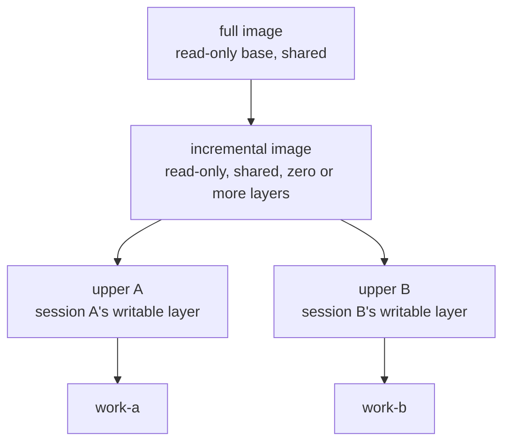

# tiler: The Builder for Your Development Workspace

[简体中文](README.zh.md)

AI coding is changing the pace of programming: it does not always have to
happen on your own computer. You can hand a task to an agent and let it change
code and run tests on a remote machine or in a temporary environment, then
bring the result back. Several agents can explore the same project at once.

Cloning a large repository or copying a directory for every task is slow.
Sharing one writable directory tends to mix changes from different tasks.

**tiler solves this with workspace image snapshots: it saves the workspace
directory as a read-only image, then creates several independent writable
workspaces from that same image.**

The name comes from laying tiles: you build a workspace from an image you
already have, the way a wall is covered with prefabricated tiles.

## From Copying Directories to Sharing a Base

Suppose your project is ready, including source code, Git history, and the files
you need. The shortest workflow is:

```bash
tiler build --image alice/app source
tiler mount alice/app work-a
git -C work-a pull
tiler mount alice/app work-b
git -C work-b pull
```

If the image comes from a Git workspace with a remote and tracking branch
configured, run `git pull` after mounting to update the workspace to the current
remote state before handing it to a task. Pulled changes go only into each
workspace's writable layer.

You can now assign the two workspaces to separate tasks. They read from the same
read-only base, while changes go into their own writable layers. When one task
changes a file, the other still sees its own version.

When finished, leave the workspaces before unmounting them:

```bash
tiler umount work-a
tiler umount work-b
```

Changes made in a session are kept and can be restored later. A task does not
copy the whole base directory again, which suits parallel AI tasks, repeated
tests, and reuse of large code trees. For example, one agent can fix a bug
while another tries a refactor. Both start from the same version and run tests
on their own. If the Git repository in the base image falls too far behind,
every sync is slow; update the image. tiler can build incremental images (Linux
only) and full images.

tiler does not require any particular kind of directory contents. A Git
repository is simply a common case. It stores file snapshots. It does not
replace Git commits and collaboration, and it does not install system
dependencies for you. The image is a filesystem image, not a Docker or OCI
image. Prepare the runtime environment separately.

## How It Works: Shared Base, Independent Changes

On Linux, both workspaces share the same read-only chain: a full image at the
bottom, with saved incremental images above it (zero or more layers, with higher
layers taking precedence). Each session adds its own upper filesystem layer. The
merged directory is the workspace that applications see.



Images are mounted through **FUSE**, which runs filesystem logic in user space
while applications access files through ordinary directories. tiler invokes
external tools to mount squashfs or erofs. Routine workspace operations do not
need root access, but the tools must be installed and the current user must have
access to `/dev/fuse`. Installing dependencies and configuring device
permissions may require administrator access. See the
[FUSE documentation](https://docs.kernel.org/filesystems/fuse/).

Once the images are mounted, tiler uses
[fuse-overlayfs](https://github.com/containers/fuse-overlayfs) to merge the
read-only image layers with a writable layer (the upper) into one directory.
Applications see a complete workspace. When multiple versions exist at the same
path, the higher layer takes precedence.

File changes use **Copy-on-Write (CoW)**. Unmodified files are read directly
from the read-only layers. Before modifying a lower-layer file, copy-up copies
it to the writable layer, where the changes are made. New files go directly into
the upper. Deleting a lower-layer file records a whiteout that hides it from the
current view while leaving the base image intact. The
[OverlayFS documentation](https://docs.kernel.org/filesystems/overlayfs.html)
explains these concepts; tiler uses the user-space fuse-overlayfs on Linux.

Storage use grows as each task makes changes. CoW does not mean each edit stores
only the bytes that changed. tiler keeps file changes separate between
workspaces; process, network, and security isolation require other mechanisms.

macOS takes a different path: it mounts DMG images through `hdiutil` and stores
writable changes in `upper.shadow`. Saving results merges the shadow changes
with the base image into a new full image, rather than appending Linux-style
incremental layers.

## Install tiler

tiler is written in Go, and its end-to-end tests use the Git project's test
framework, [git-test-lib](https://github.com/jiangxin/git-test-lib). To build
tiler, install Go 1.22 or newer and make, then get the source from the
[project repository](https://github.com/tilerworks/tiler).

```bash
git clone https://github.com/tilerworks/tiler.git
cd tiler
make build
mkdir -p "$HOME/.local/bin"
install -m 755 bin/tiler "$HOME/.local/bin/tiler"
export PATH="$HOME/.local/bin:$PATH"
tiler version
```

Add the PATH setting to your shell startup file so future terminals can find
tiler. The build produces a static binary with `CGO_ENABLED=0`. Check the system
tools with:

```bash
tiler doctor
```

`tiler doctor` reports each check separately. Install any missing dependencies
it identifies. On Linux, check that tools such as `mksquashfs`, `squashfuse_ll`,
`fuse-overlayfs`, and `fusermount3` are available and that the current user can
access `/dev/fuse`.

On Linux, image chains allow up to 32 layers by default, counting the full
image and its increments, excluding the writable session upper. Set
`max_layers` to a positive integer in the user or project `.tiler.yaml` to
change the build and mount limit. The generated user configuration includes:

```yaml
# max_layers: 32
```

Uncomment the key to override the default. At the limit, build a new full
image before adding more increments. Lowering the limit keeps existing
metadata readable for listing and cleanup.

Install the squashfs toolchain on Debian, Ubuntu, Linux Mint, and similar
distributions:

```bash
sudo apt update
sudo apt install squashfs-tools squashfuse fuse3 fuse-overlayfs
```

Install the squashfs toolchain on Fedora, RHEL, CentOS Stream, Rocky Linux, and
similar distributions:

```bash
sudo dnf install squashfs-tools squashfuse fuse3 fuse-overlayfs
```

On Rocky Linux, AlmaLinux, and CentOS Stream 9/10, prepare EPEL and CRB
before installing these packages:

```bash
sudo dnf install dnf-plugins-core epel-release
sudo dnf config-manager --set-enabled crb
```

On version 8 use `powertools` instead of `crb`. RHEL requires EPEL and its
matching CodeReady Builder repository; follow the
[EPEL setup guide](https://docs.fedoraproject.org/en-US/epel/getting-started/).
Fedora does not need EPEL. Package versions also matter: EPEL 9 ships
squashfuse 0.1.104, below the required 0.5.0 baseline. Build a current
[upstream release](https://github.com/vasi/squashfuse) when necessary.
For EROFS, install `erofs-utils erofs-fuse` from the prepared repositories.

macOS uses the system's `hdiutil` to mount DMG images and saves changes in
`upper.shadow`, so it does not need the Linux tools above. macOS support is
still experimental: functionality is incomplete, incremental images are
unsupported, and mounting is slow. Measurements for each image format appear
under Platforms and Performance below.

### Cross-compiling Linux binaries

To build static Linux binaries for the supported architectures without a Linux
machine, run:

```bash
make cross
ls dist
# dist/tiler_linux_arm64
# dist/tiler_linux_x86_64
# dist/tiler_linux_i386
```

`make cross` maps `x86_64` to `GOARCH=amd64` and `i386` to `GOARCH=386`. The
binaries use `CGO_ENABLED=0` and carry the same source-derived version as
`make build`. The target only compiles: it does not execute the binaries or
modify `bin/`, so run each binary on a matching host.

## Use Case 1: Prepare Once, Create Development Workspaces on Demand

This example clones `https://github.com/example/app.git` into `example-app`.
Substitute your own repository URL and choose unused directories and session
names. Use a standalone repository created by a normal clone, with a complete
`.git` directory and a remote and tracking branch configured.

### Step 1: Turn Existing Source Code into an Image

```bash
git clone https://github.com/example/app.git example-app
tiler build --image demo/app example-app
```

This saves the source code and `.git` together as a snapshot. In one measurement
on a local Linux disk, cloning took 52 seconds and the workspace occupied 274
MiB (including `.git`); `tiler build` took 2.4 seconds and produced a 214.9 MiB
image. Do not modify the source directory while creating the image. Linux
chooses squashfs or erofs by default according to the available toolchain; macOS
defaults to DMG. There is no need to specify a format for this basic workflow.

After packing, list the image's versions with `tiler images ls -v`:

```bash
tiler images ls -v
```

```text
📦 demo/app · 1 versions · latest: 0a2a869d90
  IMAGE                 SIZE  CREATED      LAST ACTIVITY  DESCRIPTION
  └─ 0a2a869d90 ★  214.9 MiB  11-02 11:19  11-02 11:19    -
```

The default image library is at `~/.tiler/images`, with sessions, cache, and
logs at `~/.tiler/sessions`, `~/.tiler/cache`, and `~/.tiler/logs`,
respectively. You usually do not need to touch these directories. To override
the locations, put a `.tiler.yaml` in the workspace directory or in a parent
directory. tiler searches upward from the current directory and uses the nearest
file. Its format matches the default `~/.tiler.yaml`.

### Step 2: Mount, Update, Then Start Development

```bash
mkdir work
tiler session new coding
tiler mount --session coding demo/app work
cd work
git pull
```

An image is a snapshot of the moment it was created. Mounting it does not make
the code current. Run `git pull` and update the current branch before an AI
agent or a developer starts editing, building, and testing. The image already
holds the files and Git objects, so the pull fetches only what is new on the
remote, instead of retrieving the whole project. The pull needs access to that
remote. If the session already has uncommitted changes, or the branches have
diverged, follow the project's Git workflow before updating. Skip this step for
a directory that is not a Git repository.

In the same measurement, `tiler mount` took 0.09 seconds and `git pull` in
`work` took 0.70 seconds: 0.79 seconds combined, compared with 52 seconds for a
fresh clone. Pull time depends on how much data has to be updated. This example
uses an image on a local filesystem. For performance on network-mounted storage,
see Platforms and Performance below.

To work on another task in parallel, open another terminal in the parent
directory of `example-app` and create a workspace from the same image:

```bash
mkdir work-review
tiler session new review
tiler mount --session review demo/app work-review
cd work-review
git pull
```

The two tasks update and modify their own workspaces without changing the base
image or each other's workspace. Mount directories must be empty, owned by the
current user, and outside tiler's runtime directories. After finishing the
second task, leave the directory before running `tiler session close review`.

You can also create another workspace for the same repository by running
`git worktree add` inside an already mounted directory:

```bash
git worktree add -b review ../work-wt
```

In the same measurement, this command took 0.36 seconds and created a 62 MiB
workspace, reusing Git objects from the mounted repository. For multiple
workspaces in one project, you can mount the image again or use
`git worktree add`.

### Step 3: Save a Reusable Workspace

To save changes from the first workspace, run these commands inside it:

```bash
tiler status -v .
tiler build -i
```

This incremental build took 7.7 seconds. View the new image with:

```bash
tiler images ls -v
```

The output shows the incremental image's size, 172.1 MiB, and the dependency
between the two images.

```text
📦 demo/app · 2 versions · latest: eb24b00e8c
  IMAGE                    SIZE  CREATED      LAST ACTIVITY  DESCRIPTION
  └─ 0a2a869d90       214.9 MiB  11-02 11:19  11-02 11:42    -
     └─ eb24b00e8c ★  172.1 MiB  11-02 11:42  11-02 11:42    -
```

On Linux, `build` inside a mounted view saves an incremental image by default.
When the accumulated increments plus the current upper exceed half the base
image's size, it switches to a full rebuild. Use `--incremental` to explicitly
append an increment, or `--full` to create a full snapshot. On macOS, shadow
changes are merged with the base image into a new full image.

Image snapshots are stored on a local disk or a mounted volume. Commit
important changes and push them to a Git server; do not rely on the image
alone. Creating a new image does not switch other mounted workspaces to it. On
Linux, an unmount and a later replay remove saved upper files according to the
metadata.

### Step 4: Close and Restore

Leave the mounted directory before closing the session. Reopen it when you want
to resume work:

```bash
tiler session close coding
tiler session open coding
cd work
git pull
```

Closing a regular session unmounts the workspace and preserves its changes;
reopening restores the mount. After you update the code, continue with the next
round of work. When you are done, leave the workspace again and close the
session.

For a disposable workspace, use `tiler mount --rm demo/app scratch`. Run
`git pull` inside before using it, then leave the directory and run
`tiler umount scratch` to clean up. **Warning: `--rm` deletes the temporary
session's writable data. Export your results beforehand, for example by
committing and pushing.**

The commands above use image names, which select the latest version by default.
To use a fixed version, find its ID with `tiler images ls -v` and mount
`demo/app:<version-ID>`. The
[standard workflow e2e test](test/e2e/t0100-linux-standard-workflow.sh) covers
the complete lifecycle.

## Use Case 2: Reuse Shared Images by Linking or Copying

When your team already provides an image, import it directly instead of
preparing and packing the source again. Suppose `/mnt/share/app.sqsh` is an
accessible full image file:

```bash
tiler build --image team/app --link /mnt/share/app.sqsh
tiler mount team/app work
cd work
git pull
```

Run this example in a fresh working directory; omit `git pull` if the content is
not a Git repository. When finished, leave the workspace and run
`tiler umount work`. A regular session still preserves its changes.

| Import method | Suitable for | When the source file is unavailable |
| --- | --- | --- |
| `--link` | Shared storage that remains accessible, reducing duplicate storage | New mounts fail if the source is unavailable |
| `--copy` | Keeping an independent local copy of an image | The local copy remains usable |

To keep a local copy, replace `--link` with `--copy`. The two options cannot be
used together. Importing does not modify the source file.

If the shared source is an image library directory containing full and
incremental versions, use `tiler build --image team/app --link /mnt/share/app`
to import the latest version and its required ancestor chain. Add
`--hash <version-ID>` to select a fixed version. Do not import a single
incremental payload as a substitute for the full image chain: importing a single
file does not automatically recover the base layers.

For more validation of imports, repeated mounts, and source availability, see
the [image import e2e test](test/e2e/t0101-linux-import-workflow.sh).

## Use Case 3: Split Large Images Without Changing the Workflow

When storage has a per-file size limit, Linux can split images into byte blocks
during a build. Suppose a prepared source directory named `source` already
exists:

```bash
tiler build --image team/large-app --split 2G source
tiler images show team/large-app
tiler mount team/large-app work
cd work
git pull
```

Run this example in a fresh working directory as well. `2G` is the maximum block
size; choose it according to the storage limit. A small image may have only one
block. The `payload blocks` field in the details indicates block storage.
Development, saving, and closing work the same way as with ordinary images. When
finished, leave the directory and run `tiler umount work`.

To enable splitting by default for a project, set `split_size: 2G` in its
`.tiler.yaml` instead of passing the argument each time. Both full and
incremental images can use block storage.

Blocks are slices of the image's byte stream. They are not directory partitions,
content deduplication, or new version layers. With the optional `concatfs`
installed, Linux can provide a concatenated block view directly. Otherwise, it
reconstructs the full image in the cache, so account for the cache disk's free
space and per-file limits. To check payload integrity, add `--verify` when
mounting. Valid recorded SHA-256 digests are checked, and corrupt or missing
blocks cause a failure.

For complete block storage validation, see the
[split storage e2e test](test/e2e/t0102-linux-split-workflow.sh).

## Platforms and Performance

| Platform | Image and writable storage | Requirements |
| --- | --- | --- |
| Linux | squashfs / erofs, FUSE, and an independent upper | Matching packing and mounting tools, plus `/dev/fuse` |
| macOS | DMG, `hdiutil`, and a shadow | DMG by default; does not use the Linux FUSE stack |
| Windows through WSL2 | Uses the Linux implementation | Build and run inside the distribution |

Linux does not build or mount DMG images, and macOS does not build or mount
squashfs or erofs. After a macOS shadow is saved as a new full image, a new
mount is needed to use that version; the original session remains bound to its
original base. In WSL2, keep the image library, sessions, and workspaces on the
distribution's Linux filesystem, avoiding Windows volumes such as `/mnt/c`.

### Benchmarks

The following cold-read measurements, in MiB/s, were collected with
`tiler benchmark` on a macOS development machine and a Linux virtual machine.
The payload was incompressible random data stored in 4 MiB files, with total
sizes of 32, 128, 256, and 512 MiB. Image reads are averages of two runs; the
unpacked directory was traversed once after the same cache-clearing step. Linux
and macOS ran on different machines, so compare numbers only within each host.
See the [benchmark documentation](docs/benchmark.md) for packing, warm reads,
and variance.

The Linux host was an aarch64 virtual machine with 6 vCPUs, 11 GiB of memory,
Ubuntu 24.04, and ext4 on virtio. squashfs used zstd; the host's erofs tools
lacked zstd, so erofs used lz4. Read-only mounting took 6–38 milliseconds.
Packing throughput was 87–120 MiB/s for squashfs, 94–106 MiB/s for erofs, and
about 46 MiB/s for tar.gz.

| MiB | Unpacked directory | squashfs | erofs | tar.gz |
| --- | --- | --- | --- | --- |
| 32 | 2651.9 | 761.9 | 1254.9 | 1561.0 |
| 128 | 2628.9 | 842.1 | 1015.9 | 1641.0 |
| 256 | 2209.8 | 1207.5 | 1127.8 | 1575.4 |
| 512 | 2042.2 | 1037.5 | 986.5 | 1141.6 |

The macOS host was an Apple M3 Pro with 36 GiB of memory and APFS. Cold reads
of a DMG stayed around 330–380 MiB/s, about 16–22% as fast as reading the
unpacked directory on the same machine. Attaching took about 2.7–3.0 seconds
and changed little with size. `hdiutil create` has about 6.8 seconds of fixed
overhead, so throughput was only 4.7 MiB/s at 32 MiB and rose to 45.4 MiB/s at
512 MiB. Packing a tar.gz on the same machine ran at about 48–52 MiB/s.

| MiB | Unpacked directory | DMG | tar.gz | attach |
| --- | --- | --- | --- | --- |
| 32 | 1600.0 | 326.5 | 941.2 | 2.672 s |
| 128 | 2285.7 | 359.6 | 1790.2 | 2.956 s |
| 256 | 1718.1 | 369.9 | 1903.3 | 3.048 s |
| 512 | 2275.6 | 383.8 | 2102.7 | 2.694 s |

Reusing images reduces the time spent copying and unpacking directories. Initial
code retrieval and packing still have a cost. Actual performance also depends on
image transfers, cold-cache reads, the user-space filesystem, and the amount of
modified data. Each additional task needs space for its writable data.

Cold-read throughput does not directly predict speedups for workspace operations
or compilation. In this random-data test, reading tar.gz is close to
sequentially reading a single file. The formats may rank differently with a
compressible source tree. See `tiler benchmark --help` to run measurements on
your own disk or NAS.

When evaluating performance, measure initial code retrieval and image creation
separately from later task startup, file reads, and saving changes. Test with a
real repository and realistic changes, rather than relying on a single mount
time.

## FAQ

### Build Fails Because the Image Toolchain Is Incomplete

If building an image fails with the following error:

```console
$ tiler build -I my/app
Error: build: no complete image toolchain; check the environment with tiler doctor
```

Run `tiler doctor` to diagnose the environment:

```sh
tiler doctor
```

Follow its output to install missing dependencies or fix the environment, then
retry the build.

### Interpret the Doctor Report

The following example comes from an Ubuntu container. Paths, versions,
and available tools depend on the environment.

```console
$ tiler doctor
📋 Config

  path          /root/.tiler.yaml
  images_dir    /root/.tiler/images
  sessions_dir  /root/.tiler/sessions
  cache_dir     /root/.tiler/cache
  logs_dir      /root/.tiler/logs
  log_level     info

🔧 Checks

  fuse_device          fail  stat /dev/fuse: no such file or directory; Hint: check that the host supports FUSE and
                             /dev/fuse exists and is accessible to the current user. In a container, check FUSE device
                             access and CAP_SYS_ADMIN. For Docker, start the container with: --device /dev/fuse
                             --cap-add SYS_ADMIN. If permissions are already configured, check seccomp/AppArmor/SELinux
                             restrictions on FUSE mounts.
  fuse_overlayfs       fail  fuse-overlayfs: exec: "fuse-overlayfs": executable file not found in $PATH; install: sudo
                             apt install fuse-overlayfs
  fusermount3          fail  fusermount3: exec: "fusermount3": executable file not found in $PATH; install: sudo apt
                             install fuse3
  git                  pass  2.53.0
  image_toolchain      fail  no complete image stack: erofs missing mkfs.erofs, erofsfuse; squashfs missing mksquashfs,
                             squashfuse_ll; install: sudo apt install erofs-utils erofsfuse squashfs-tools squashfuse
  squashfuse_subdir    warn  squashfuse_ll is not installed; install: sudo apt install squashfuse
  file_limit_images    info  not present, skipped
  file_limit_cache     info  not present, skipped
  storage_perf_images  info  not present, skipped
  storage_perf_cache   info  not present, skipped
  cache_advice         info  no storage comparison without measurements from both directories
  contrib_concatfs     warn  optional tool; sources ship in the contrib/ directory of the tiler source tree with origin,
                             license, and build notes; an on-site build needs gcc and libfuse3-dev and takes about a
                             second; tiler never installs it automatically
  contrib_slowfs       warn  optional tool; sources ship in the contrib/ directory of the tiler source tree with origin,
                             license, and build notes; an on-site build needs gcc and libfuse3-dev and takes about a
                             second; tiler never installs it automatically
Error: doctor: failing probes: fuse_device, fuse_overlayfs, fusermount3, image_toolchain
```

Read the report as follows:

- **Config** shows the configuration file path, effective storage directories,
  and log level. Here tiler runs as root, so the paths are under `/root`.
- **Statuses**: `pass` means the check passed; `fail` means it failed; `warn`
  calls for attention but does not fail the command; `info` provides context or
  explains a skipped check. Any `fail` makes `doctor` exit with status 1. The
  final error lists the failed probes.
- **FUSE device**: `/dev/fuse` is missing from this container. Check that the
  host supports FUSE and exposes the device, then recreate the Docker container
  with `--device /dev/fuse --cap-add SYS_ADMIN` added to its startup options.
  Installing packages inside the container alone does not expose the device.
  If access still fails, check user permissions and seccomp/AppArmor/SELinux
  restrictions.
- **Required tools**: `fuse-overlayfs` and `fusermount3` are missing from
  `$PATH`. The suggested Ubuntu packages are `fuse-overlayfs` and `fuse3`.
  Neither image toolchain is complete. At least one complete stack is needed:
  squashfs uses `mksquashfs` and `squashfuse_ll`; erofs uses `mkfs.erofs` and
  `erofsfuse`. The report lists packages for both; installing both stacks is
  optional. For example, install the FUSE tools and the squashfs stack with:

  ```sh
  sudo apt install fuse-overlayfs fuse3 squashfs-tools squashfuse
  ```

  When already running as root, omit `sudo`.
- **Other results**: Git passed. `squashfuse_subdir` warns because
  `squashfuse_ll` is absent. The file-limit and storage-performance checks were
  skipped because the image and cache directories do not exist yet; without
  both measurements, `cache_advice` cannot compare them. The `contrib_*`
  warnings describe optional tools, not required dependencies; their source,
  license, and build notes are in `contrib/`, and tiler never installs them
  automatically.

After fixing device access and installing the required tools, rerun
`tiler doctor`, resolve any remaining failures, and retry the build.

### What Is the Difference Between `tiler session` and `tiler mount`?

`tiler session` manages sessions. A session can contain multiple mounts, and
you can choose its name when creating it with `tiler session new <name>`.
`tiler mount` creates a mount and records it in a session. Use `-s <session>`
to associate the mount with an existing session, for example:

```sh
tiler session new coding
tiler mount -s coding my/app my-project
tiler mount -s coding my/tools my-tools
```

Without `-s <session>` (or `--session`) and with no `TILER_SESSION_ID` environment
variable set, `tiler mount` automatically creates a session and associates the
mount with it. Such a session usually contains just one mount:

```sh
tiler mount my/app my-project
```

### How Do I Remove Expired Sessions and Images?

Sessions and image versions expire after 30 days without activity by default.
Use `tiler session ls` and `tiler images ls` to see their last activity times:

```sh
tiler session ls
tiler images ls
```

Run the following commands to clean up expired sessions and image versions:

```sh
tiler session gc
tiler images gc
```

Each command lists cleanup candidates and asks for `yes` before deleting them.
Without `--yes`, a noninteractive run only previews candidates. Use `--expire`
to change the default 30-day retention period.

Session GC keeps mounted or busy sessions. Removing a session also deletes its
writable data, including the upper layers. Image GC keeps versions referenced
by sessions and ancestors needed by retained versions. Cleaning up sessions
first can release image references so image GC can remove those versions.

### Recover Unexported Data After Mounts Are Lost

If mounts disappear after a crash or reboot, tiler can restore the mounts and
automatically recover the data.

First, use `tiler status` to inspect the mounts:

```console
$ tiler status
clever-owl · active · missing-mounts
  my/app:4ab665e99f → my-project  [rw · stale]
```

The `clever-owl` session created by `tiler mount` is still recorded as `active`,
but `missing-mounts` reports missing mounts. Here `stale` means the recorded
mount is no longer usable; it does not mean the saved data has expired.

Restore the session's mounts with:

```sh
tiler session open clever-owl
```

`session open` restores dead or missing mounts and skips healthy views. After
opening the session, inspect the details with `tiler status -v`:

```console
$ tiler status -v
clever-owl · active
  Created: 11-03 14:16 · Last activity: 11-03 14:24

  📁 my/app:4ab665e99f  →  my-project  [rw · mounted · healthy]
     ├─ full         4ab665e99f  ../.tiler/sessions/clever-owl/runtime/m1/lower-0
     └─ overlay
        ├─ upper     ../.tiler/sessions/clever-owl/runtime/m1/upper
        └─ lower     [highest priority first]
           └─ ../.tiler/sessions/clever-owl/runtime/m1/lower-0
```

`mounted · healthy` confirms that the view is mounted and usable again. The
`upper` layer holds user-created and modified data; do not manually change its
contents. Enter the mount directory (`my-project` in this example) to check and
recover your files through the restored view:

```sh
cd my-project
ls
```

### Can I Mount a Subdirectory of an Image?

Yes, on Linux: `tiler mount --subdir <path>` exposes an image subdirectory as
the mount root. macOS DMG images do not support `--subdir`; tiler rejects it
with `mount: --subdir is not available for dmg`.

Some users mount Git directories from images as local reference repositories
to accelerate clones. Git borrows existing objects locally and fetches
missing objects from the remote. This can reduce network transfer, although
actual gains depend on how much history the reference and remote share.

This Linux example assumes two full images are already available:
`demo/superproject` for a superproject containing the submodule
`deps/subproject`, and `demo/subproject` for a standalone checkout of that
subproject. Each image contains a real `.git` directory; a submodule's `.git`
file pointing into another repository cannot serve as that directory.

Mount each image's `.git` subdirectory. The mounts use writable overlays so
`core.bare` can be set for each reference repository; these configuration
changes leave the image payloads unchanged.

```sh
demo_root=$(pwd -P)
mkdir -p references clones
tiler session new reference-demo
tiler mount -s reference-demo --subdir .git \
  demo/superproject references/superproject.git
tiler mount -s reference-demo --subdir .git \
  demo/subproject references/subproject.git

git --git-dir=references/superproject.git config core.bare true
git --git-dir=references/subproject.git config core.bare true
```

Clone the superproject from its remote using the mounted local reference,
then initialize the submodule with its own reference:

```sh
git clone --reference "$demo_root/references/superproject.git" \
  https://example.com/superproject.git clones/my-project
git -C clones/my-project submodule update --init \
  --reference "$demo_root/references/subproject.git" deps/subproject
```

Replace `https://example.com/superproject.git` with your superproject's remote
URL. The submodule is cloned from the URL recorded in `.gitmodules`.

Inspect the mounts, check both repositories, and verify their object sources:

```sh
tiler status -v
git -C clones/my-project submodule status
git -C clones/my-project fsck --full
git -C clones/my-project/deps/subproject fsck --full
cat clones/my-project/.git/objects/info/alternates
cat clones/my-project/.git/modules/deps/subproject/objects/info/alternates
```

The mounts should be `mounted · healthy`, and the two `alternates` files should
point to the respective mounted reference's `objects` directory. Plain
`--reference` keeps this dependency: keep the mounts available while using the
clones.

You can also build and mount an image of the entire workspace, including its
initialized submodules, and work directly in that mounted view. Separate
reference repositories are optional.

### Main tiler Commands

| Command | Purpose |
| --- | --- |
| `tiler build -I <image> [dir]` | Build a full or incremental image from a directory or mounted workspace. |
| `tiler mount [-s <session>] <image> <dir>` | Mount an image as a writable workspace; use `--read-only` for a read-only view or `--subdir <path>` for a subdirectory on Linux. |
| `tiler umount <dir>` | Unmount a workspace by path. |
| `tiler status [-v]` | Check session mounts against their actual state; `-v` shows layer details. |
| `tiler images ls [-v]` | List images and their latest activity; `-v` shows the version tree. |
| `tiler images show <image>` | Show an image repository or version in detail. |
| `tiler images describe <name>:<hash>` | Update an image version's description. |
| `tiler images remove <image>` | Remove an image repository or version subtree. |
| `tiler images gc` | Clean up expired, unreferenced image versions. |
| `tiler session new [name]` | Create an empty session with a chosen or generated name. |
| `tiler session ls [-v]` | List sessions and their latest activity; `-v` shows mount details. |
| `tiler session show <name>` | Show a session record in detail. |
| `tiler session open <name>` | Restore or ensure the session's mounts. |
| `tiler session close <name>` | Unmount the session's views and close the session. |
| `tiler session remove <name>` | Delete a closed session and its writable data. |
| `tiler session gc` | Clean up expired idle sessions and their writable data. |
| `tiler doctor` | Diagnose the local toolchain, FUSE access, and storage environment. |
| `tiler benchmark <path>` | Measure image packing and read performance. |
| `tiler version` | Print the tiler version. |
| `tiler help [command]` | Show command usage and options. |

Report issues and suggestions in the
[project repository](https://github.com/tilerworks/tiler).

This project is released under the [MIT](LICENSE) license.
