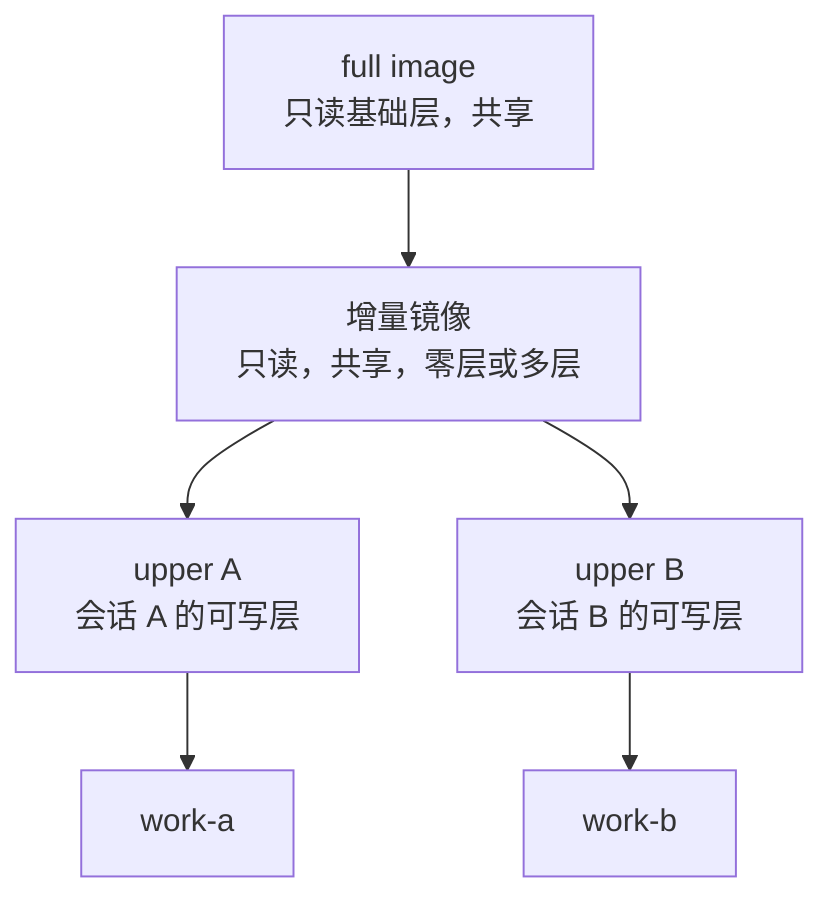

# tiler：像铺瓷砖一样，用镜像快速重建工作区

[English](README.md)

AI Coding 正在改变编程的节奏：编程不必始终发生在自己的电脑上，把任务交给代理，让它在远端机器或临时环境里修改代码、运行测试，再带回结果。同一项目也可以同时交给多个代理探索。

为每个任务重新 clone 大仓库或复制目录很费时间。而直接共用一个可写目录，又容易让不同任务的修改混在一起。

**tiler 使用工作区镜像快照解决这个问题：将工作区目录保存为只读镜像，再从同一份镜像复制多个独立可写的工作区。**

名字 tiler 意为“瓦工”：像用预制瓷砖铺墙一样，用已有镜像搭建工作区。

## 从复制目录，到共享基础

假设项目已经准备妥当，包含源码、Git 历史和所需的文件。最短的使用流程是：

```bash
tiler build --image alice/app source
tiler mount alice/app work-a
git -C work-a pull
tiler mount alice/app work-b
git -C work-b pull
```

如果镜像来自已配置远端和跟踪分支的 Git 工作区，挂载后先执行 `git pull`，将工作区更新到远端当前状态，再交给任务使用。拉取的变化只写入各自的可写层。

现在，两个工作区可以分别交给两个任务。它们读取相同的只读基础，修改落入各自的可写层。一个任务修改文件，另一个仍能看到自己的版本。

用完后，先退出工作区，再卸载：

```bash
tiler umount work-a
tiler umount work-b
```

会话中的修改会保留，后续可以恢复。每个任务无需重新复制整棵基础目录，适合并行 AI 任务、重复测试和大型代码树复用。例如，一个代理修复问题，另一个代理尝试重构，两者从相同版本出发，独立运行测试。如果基础镜像中的 Git 仓库落后太多，每次同步都很慢，可以更新镜像。tiler 支持构建增量镜像（仅 Linux）和完整镜像。

tiler 对目录内容没有特殊要求，Git 仓库只是一个常见场景。它保存文件快照，不替代 Git 的提交与协作，也不会替你安装系统依赖。这里的镜像是文件系统镜像，不是 Docker/OCI 镜像；运行环境仍需另外准备。

## 原理：基础共享，修改独立

在 Linux 上，两个工作区共享同一条只读链：最底下是完整镜像，上面是已保存的增量镜像（可以没有，也可以有多层，较上层优先）。每个会话再叠自己的上层文件系统，合并后的目录才是应用看到的工作区。



镜像通过 **FUSE** 挂载。FUSE 让文件系统逻辑运行在用户态，应用仍通过普通目录访问文件。tiler 调用外部工具挂载 squashfs 或 erofs，日常工作区操作无需 root 权限。系统需要安装相应工具，并允许当前用户访问 `/dev/fuse`；安装依赖和配置设备权限可能需要管理员操作。参见 [FUSE 文档](https://docs.kernel.org/filesystems/fuse/)。

挂载后，tiler 使用 [fuse-overlayfs](https://github.com/containers/fuse-overlayfs) 将只读镜像层与可写层（upper）合并成一个目录。应用看到的是完整工作区。同一路径出现多个版本时，上层内容优先。

文件修改采用**写时复制（Copy-on-Write，CoW）**。未修改的文件直接从只读层读取；修改下层文件时，先通过 copy-up 将文件复制到可写层，再写入修改；新增文件直接写入 upper。删除下层文件则记录遮蔽信息，使其在当前视图中不可见，基础镜像保持不变。[OverlayFS 文档](https://docs.kernel.org/filesystems/overlayfs.html)介绍了这些概念；tiler 在 Linux 上使用的是用户态的 fuse-overlayfs。

各任务的修改越多，占用的存储也越多。CoW 不代表每次修改都只保存变化的几个字节。tiler 隔离各工作区的文件修改；进程、网络和安全隔离需要其他机制。

macOS 使用另一条路径：通过 `hdiutil` 挂载 DMG，以 `upper.shadow` 保存可写变化。保存成果时，将 shadow 中的修改与基础镜像合成一份新的完整镜像，而不是追加 Linux 式增量层。

## 安装 tiler

tiler 使用 Go 语言开发，端到端（e2e）测试使用 Git 项目的测试框架 [git-test-lib](https://github.com/jiangxin/git-test-lib)。构建前先安装 Go 1.22 或更新版本以及 make，再从[项目仓库](https://github.com/tilerworks/tiler)获取源码。

```bash
git clone https://github.com/tilerworks/tiler.git
cd tiler
make build
mkdir -p "$HOME/.local/bin"
install -m 755 bin/tiler "$HOME/.local/bin/tiler"
export PATH="$HOME/.local/bin:$PATH"
tiler version
```

将 PATH 设置加入 shell 启动文件，后续终端就能找到 tiler。构建产物是 `CGO_ENABLED=0` 的静态二进制。运行以下命令检查系统工具是否齐全：

```bash
tiler doctor
```

`tiler doctor` 会逐项报告检查结果。根据输出补齐依赖；在 Linux 上，需要确认 `mksquashfs`、`squashfuse_ll`、`fuse-overlayfs`、`fusermount3` 等工具可用，且当前用户能访问 `/dev/fuse`。

Debian、Ubuntu、Linux Mint 等安装 squashfs 工具链：

```bash
sudo apt update
sudo apt install squashfs-tools squashfuse fuse3 fuse-overlayfs
```

Fedora、RHEL、CentOS Stream、Rocky Linux 等安装 squashfs 工具链：

```bash
sudo dnf install squashfs-tools squashfuse fuse3 fuse-overlayfs
```

macOS 使用系统的 `hdiutil` 挂载 DMG，以 `upper.shadow` 保存修改，无需安装上述 Linux 工具。目前 macOS 支持仍处于技术验证阶段，功能尚不完整，不支持增量镜像，挂载也较慢。各类镜像格式的测量结果见下文“平台与性能”。

## 用例一：准备一次，按需创建开发工作区

下面以 `https://github.com/example/app.git` 为例，将仓库克隆到 `example-app`。请换成自己的仓库地址，并选择未占用的目录和会话名。`example-app` 应是普通 clone 得到的独立仓库，包含完整的 `.git` 目录，并已配置远端和跟踪分支。

### 步骤 1：把已有源码制成镜像

```bash
git clone https://github.com/example/app.git example-app
tiler build --image demo/app example-app
```

这一步把源码和 `.git` 一起保存为快照。一次 Linux 本地磁盘上的测量：克隆用了 52 秒，工作区占 274 MiB（含 `.git`）；`tiler build` 用了 2.4 秒，得到 214.9 MiB 的镜像。制作镜像时，不要修改源目录。Linux 默认根据工具链选择 squashfs 或 erofs，macOS 默认使用 DMG，无需为这个基本流程指定格式。

打包完成后，用 `tiler images ls -v` 查看这个镜像的版本：

```bash
tiler images ls -v
```

```text
📦 demo/app · 1 versions · latest: 0a2a869d90
  IMAGE                 SIZE  CREATED      LAST ACTIVITY  DESCRIPTION
  └─ 0a2a869d90 ★  214.9 MiB  11-02 11:19  11-02 11:19    -
```

默认镜像库位于 `~/.tiler/images`，会话、缓存和日志分别位于 `~/.tiler/sessions`、`~/.tiler/cache` 和 `~/.tiler/logs`。通常不必直接操作这些内部目录。可以在工作区目录或其父目录放置 `.tiler.yaml` 覆盖这些位置；tiler 从当前目录向上查找，较近的文件优先。格式与默认的 `~/.tiler.yaml` 相同。

### 步骤 2：挂载后先更新，再开始开发

```bash
mkdir work
tiler session new coding
tiler mount --session coding demo/app work
cd work
git pull
```

镜像是制作时的快照，挂载并不意味着代码已是最新。先执行 `git pull`，完成当前分支的更新，再让 AI 或开发者开始修改、构建和测试。相比从头获取项目，这时已有镜像中的文件与 Git 对象可供复用，只需获取远端新增的内容。拉取需要能够访问项目远端。如果会话中已有未提交修改或分支发生分歧，应先按项目的 Git 工作流处理，再继续更新。非 Git 目录不需要这一步。

同一次测量中，`tiler mount` 用了 0.09 秒，随后在 `work` 中执行 `git pull` 用了 0.70 秒，合计 0.79 秒；从头克隆则用了 52 秒。拉取耗时取决于需要更新的数据量。本例使用本地文件系统上的镜像；网络挂载存储的性能讨论见下文“平台与性能”。

需要并行处理另一项任务时，在 `example-app` 的父目录打开另一个终端，从同一镜像创建工作区：

```bash
mkdir work-review
tiler session new review
tiler mount --session review demo/app work-review
cd work-review
git pull
```

两个任务各自更新和修改，不会改动基础镜像或对方的工作区。挂载目录必须为空、由当前用户拥有，并位于 tiler 的运行时目录之外。完成第二个任务后，先离开目录再执行 `tiler session close review`。

同一仓库的另一个工作区，也可以在已经挂载的目录里用 `git worktree add` 创建：

```bash
git worktree add -b review ../work-wt
```

同一次测量中，这条命令用了 0.36 秒，新工作区占 62 MiB，复用了已挂载仓库的 Git 对象。同一项目需要多个工作区时，可以再次挂载镜像，也可以使用 `git worktree add`。

### 步骤 3：保存可复用的工作区

要保存第一个工作区中的修改，在该工作区中执行：

```bash
tiler status -v .
tiler build -i
```

这次增量构建用了 7.7 秒。查看新镜像：

```bash
tiler images ls -v
```

从命令输出可以看到增量镜像大小为 172.1 MiB，以及两个镜像之间的依赖关系。

```text
📦 demo/app · 2 versions · latest: eb24b00e8c
  IMAGE                    SIZE  CREATED      LAST ACTIVITY  DESCRIPTION
  └─ 0a2a869d90       214.9 MiB  11-02 11:19  11-02 11:42    -
     └─ eb24b00e8c ★  172.1 MiB  11-02 11:42  11-02 11:42    -
```

Linux 上，挂载视图内的 `build` 默认保存增量；累计增量加当前 upper 超过基础镜像大小的一半时，会转为完整重建。可用 `--incremental` 明确追加增量，或用 `--full` 制作完整快照。macOS 则将 shadow 中的修改与基础镜像合成一份新的完整镜像。

镜像快照保存在本地或挂载磁盘上。重要修改应及时提交并推送到 Git 服务器，不要只依赖镜像保存。生成新镜像后，其他已挂载工作区不会自动切换版本。Linux 上，卸载和后续重放会根据元数据清理已保存的 upper 文件。

### 步骤 4：关闭与恢复

先离开挂载目录，再关闭会话。需要继续工作时，重新打开：

```bash
tiler session close coding
tiler session open coding
cd work
git pull
```

关闭普通会话会卸载工作区并保留修改；重新打开会恢复挂载。更新好代码后，可以继续下一轮开发。结束时再次离开工作区并关闭会话。

若只需一次性工作区，可用 `tiler mount --rm demo/app scratch`；在其中先执行 `git pull` 再使用，退出目录后用 `tiler umount scratch` 清理。**警告：`--rm` 会删除该临时会话的可写数据，成果应提前导出（如：提交并推送）。**

以上命令直接使用镜像名，默认选择最新版本。需要固定版本时，用 `tiler images ls -v` 查看版本 ID，再挂载 `demo/app:<版本ID>`。完整生命周期的自动化测试见[标准工作流 e2e](test/e2e/t0100-linux-standard-workflow.sh)。

## 用例二：复用共享镜像，选择链接或复制

团队已经提供镜像时，可以直接导入，无需重新准备源码并打包。下面假设 `/mnt/share/app.sqsh` 是一个可访问的完整镜像文件：

```bash
tiler build --image team/app --link /mnt/share/app.sqsh
tiler mount team/app work
cd work
git pull
```

这个例子应在一个新的工作目录下执行；如果内容不是 Git 仓库，省略 `git pull`。完成后离开工作区，执行 `tiler umount work`，普通会话仍会保留修改。

| 导入方式 | 适用场景 | 源文件不可用时 |
| --- | --- | --- |
| `--link` | 持续可访问的共享存储，减少重复存储 | 源文件不可用时无法新建挂载 |
| `--copy` | 希望将镜像保存在本地独立使用 | 本地副本仍可使用 |

要复制到本地，将导入命令中的 `--link` 换为 `--copy`，两者不能同时使用。导入不会修改源文件。

如果共享的是带有完整与增量版本的镜像库目录，可使用 `tiler build --image team/app --link /mnt/share/app` 导入最新版本及所需祖先链；需要固定版本时，再加 `--hash <版本ID>`。不要单独导入一个增量载荷来替代完整镜像链：单文件导入不会自动找回基础层。

更多导入、重复挂载和源可用性验证见[镜像导入 e2e](test/e2e/t0101-linux-import-workflow.sh)。

## 用例三：大镜像拆分存储，使用方式不变

当存储介质有单文件大小限制时，Linux 可以在构建时启用字节块拆分。假设已有一个准备好的源码目录 `source`：

```bash
tiler build --image team/large-app --split 2G source
tiler images show team/large-app
tiler mount team/large-app work
cd work
git pull
```

这个例子同样在新的工作目录下执行。`2G` 是每块的大小上限，应根据存储限制选择；小镜像可能只有一个块。详情中的 `payload blocks` 表明采用了块存储。挂载后的开发、保存与关闭流程和普通镜像相同，结束后离开目录并执行 `tiler umount work`。

若希望项目默认启用拆分，可在项目 `.tiler.yaml` 中设置 `split_size: 2G`，不必每次传参。完整镜像和增量都可采用块存储。

块是镜像字节流的切片，不是按目录划分，也不是内容去重或新的版本层。安装可选的 `concatfs` 后，Linux 可直接提供块拼接视图；否则会在缓存中重组完整镜像，仍需考虑缓存磁盘的空间和单文件限制。需要检查载荷完整性时，为挂载加上 `--verify`；已记录的有效 SHA-256 摘要会参与校验，损坏或缺失的块会导致失败。

完整的块存储验证见[拆分存储 e2e](test/e2e/t0102-linux-split-workflow.sh)。

## 平台与性能

| 平台 | 镜像与可写方式 | 使用条件 |
| --- | --- | --- |
| Linux | squashfs / erofs，FUSE 与独立 upper | 对应打包、挂载工具和 `/dev/fuse` |
| macOS | DMG，`hdiutil` 与 shadow | 默认 DMG，不使用 Linux 的 FUSE 栈 |
| Windows 经 WSL2 | 使用 Linux 实现 | 在发行版内部构建与运行 |

Linux 不构建或挂载 DMG，macOS 不构建或挂载 squashfs、erofs。macOS 的 shadow 保存为新完整镜像后，需要新挂载来使用该版本；原会话仍绑定原来的基础。WSL2 中应把镜像库、会话和工作区放在发行版的 Linux 文件系统内，避免放到 `/mnt/c` 等 Windows 卷上。

### 基准测量

下面是在一台 macOS 开发机和一台 Linux 虚拟机上用 `tiler benchmark` 测得的冷读取吞吐，单位为 MiB/s。测试使用不可压缩的随机数据，每个文件 4 MiB，总大小分别为 32、128、256、512 MiB。镜像读取结果取两次运行的平均值；展开目录的结果来自同样清理缓存后的一次遍历。Linux 与 macOS 是两台机器，数字只在各自主机内比较。打包、热缓存读取和方差见[基准文档](docs/benchmark.md)。

Linux 测试环境为虚拟机：aarch64，6 vCPU，11 GiB，Ubuntu 24.04，virtio 上的 ext4。squashfs 使用 zstd；这台机器的 erofs 工具没有 zstd，打包选用 lz4。只读挂载耗时 6–38 毫秒。打包吞吐为 squashfs 87–120 MiB/s，erofs 94–106 MiB/s，tar.gz 约 46 MiB/s。

| MiB | 展开目录 | squashfs | erofs | tar.gz |
| --- | --- | --- | --- | --- |
| 32 | 2651.9 | 761.9 | 1254.9 | 1561.0 |
| 128 | 2628.9 | 842.1 | 1015.9 | 1641.0 |
| 256 | 2209.8 | 1207.5 | 1127.8 | 1575.4 |
| 512 | 2042.2 | 1037.5 | 986.5 | 1141.6 |

macOS 主机是 Apple M3 Pro，36 GiB，APFS。DMG 冷读取吞吐约为 330–380 MiB/s，是同机展开目录的 0.16–0.22 倍。attach 约 2.7–3.0 秒，随尺寸变化不大。`hdiutil create` 有约 6.8 秒的固定开销，32 MiB 只有 4.7 MiB/s，到 512 MiB 升到 45.4 MiB/s；同机 tar.gz 打包吞吐约为 48–52 MiB/s。

| MiB | 展开目录 | DMG | tar.gz | attach |
| --- | --- | --- | --- | --- |
| 32 | 1600.0 | 326.5 | 941.2 | 2.672 s |
| 128 | 2285.7 | 359.6 | 1790.2 | 2.956 s |
| 256 | 1718.1 | 369.9 | 1903.3 | 3.048 s |
| 512 | 2275.6 | 383.8 | 2102.7 | 2.694 s |

复用镜像可以减少重复复制和展开目录的时间。首次获取代码和打包仍有开销，实际性能也受镜像传输、冷缓存读取、用户态文件系统和修改量的影响。每增加一个任务，还需要为它的可写数据留出空间。

冷读取吞吐不能直接换算为工作区操作或编译的加速倍数。在这组随机数据测试中，读取 tar.gz 接近顺序读取单个文件；换成可压缩的源码树，各格式的性能排序可能不同。用 `tiler benchmark --help` 查看测量方法，在自己的磁盘或 NAS 上测试。

评估时，分别记录首次获取代码、制作镜像，以及后续启动任务、读取文件和保存修改的耗时。使用真实仓库和实际修改量测试，不要只看单次挂载时间。

更多参数见 `tiler --help`、`tiler build --help` 和 `tiler session --help`。问题与建议请提交到[项目仓库](https://github.com/tilerworks/tiler)。

本项目以 [MIT](LICENSE) 许可证发布。
